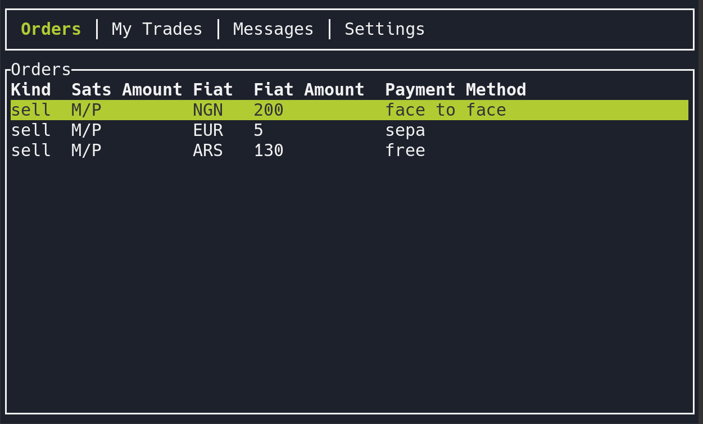

# MostriX

MostriX is a Mostro client with a TUI (Terminal User Interface). It has two modes:

- **User mode**, to trade: order book with filters and sorting, create and take orders, chat with your counterparty, cooperative cancellation, rating, and disputes with the solver.
- **Admin mode**, for dispute solvers and node operators: take disputes, chat with both parties, settle or cancel, slash [anti-abuse bonds](./anti-abuse-bond.md) and register solvers.



> **Note:** MostriX is still evolving. If you find a bug, please report it.

## Installation

Pre-built binaries for Linux, macOS, FreeBSD and Windows are available on [GitHub Releases](https://github.com/MostroP2P/mostrix/releases). Releases are signed: import the maintainers' keys from the repository's `keys/` folder, check `manifest.txt` with `gpg --verify manifest.txt.sig.arkanoider manifest.txt`, and then the binary's hash:

```bash
sed 's#  artifact-[^/]*/#  #' manifest.txt | sha256sum -c --ignore-missing
# macOS: replace sha256sum -c with shasum -a 256 -c
```

Or build it from source (requires Rust 1.97 or newer):

```bash
git clone https://github.com/MostroP2P/mostrix.git
cd mostrix
cargo run --release
```

## Features

- Order book with filters and sorting
- Create buy and sell orders, including range orders and full privacy orders
- Take orders (buy and sell), with your Lightning address
- Confirm fiat sent and release sats
- Add a new invoice if a payment fails
- End-to-end encrypted chat with your counterparty, with file attachments
- Cooperative cancellation and rating
- Open a dispute and chat with the solver; share the trade's chat key with them
- Your own reputation on the status bar
- Restore your session from the node
- Automatic 12-word seed generation and key management according to the Mostro protocol
- Admin mode for solvers: take disputes, chat with both parties, settle, cancel and slash bonds, read the reports of [Serbero](./disputes.md#serbero-the-automated-assistant), and receive Telegram alerts through mostro-watchdog

MostriX speaks only Mostro protocol v2 (since version 0.3.1). It does not yet support [importing your reputation](./reputation-import.md).

## Configuration

On first run, MostriX creates `~/.mostrix/` with your new 12-word seed and a `settings.toml` file, and shows you the 12 words: write them down. Most options can be changed from the **Settings** tab (press Shift+H there for help on each one).

Main parameters of `settings.toml`:

- `mostro_pubkey`: public key of the Mostro node (or **Settings → Select Mostro Instance**)
- `nsec_privkey`: your trader identity, derived from the seed; don't edit it
- `relays`: list of relays to connect to
- `currencies_filter`: currencies to show; empty shows all
- `user_mode`: `user` or `admin` (or **Settings → Switch Mode**)
- `ln_address`: your Lightning address
- `admin_privkey`: for solvers, the key registered as solver on the node; for the node operator, the Mostro daemon's own private key (the one behind `mostro_pubkey`), which is needed to add solvers

Use the arrow keys to move between tabs, Ctrl+H for context help, and the **Exit** tab to quit.

## More Information

MostriX is a FOSS project. You can visit its [GitHub repository](https://github.com/MostroP2P/mostrix) to learn more about its development, report bugs, or propose improvements. Node operators can find more about its admin mode in the [guide to running a Mostro node](https://mostro.community/guide).
