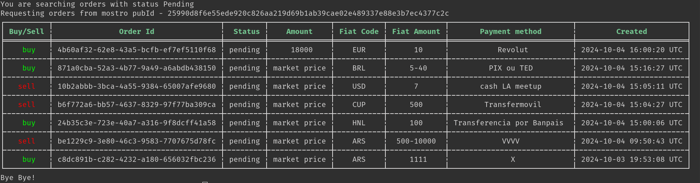

# Mostro CLI

Mostro CLI is a Mostro client with a command-line interface. It is primarily used by developers and advanced users to test the latest Mostro features and to automate operations.



## Installation

You can install Mostro CLI directly from crates.io:

```bash
cargo install mostro-cli
```

Or build it manually:

```bash
git clone https://github.com/MostroP2P/mostro-cli.git
cd mostro-cli
cargo build --release
```

Requirements: Rust 1.97 or newer. On Debian/Ubuntu you also need `sudo apt install -y cmake build-essential pkg-config libssl-dev`.

Pre-built binaries for Linux, FreeBSD and Windows are also available on [GitHub Releases](https://github.com/MostroP2P/mostro-cli/releases) (there is no macOS binary; use `cargo install`). Check the download against the release's `manifest.txt`:

```bash
sed 's#  artifact-[^/]*/#  #' manifest.txt | sha256sum -c --ignore-missing
# Windows (PowerShell): Get-FileHash <file> -Algorithm SHA256, then compare with manifest.txt
```

## Features

- Create buy and sell orders
- Take orders from the order book
- Support for range orders (min-max)
- Create buy orders with Lightning Address
- Chat with your counterparty (Mostro protocol v2, NIP-44 encrypted)
- Identity management from a 12-word phrase (NIP-06), stored in `~/.mcli/mcli.db`: back it up
- Full dispute flow, including the chat with the solver (`disputechat`)
- Claim your share of a forfeited [anti-abuse bond](./anti-abuse-bond.md) (`addbondinvoice`)
- Restore your identity and list the orders and disputes Mostro holds for you (`restore`)
- Administration commands for Mostro operators and solvers

Mostro CLI speaks only protocol v2 (since version 0.16.2), like current Mostro nodes. It does not yet support [importing your reputation](./reputation-import.md), and it can only create [stablecoin and other-network bitcoin](./stablecoins.md) orders at a fixed price.

## Basic Usage

```bash
# Set environment variables (replace the variables as needed)
export MOSTRO_PUBKEY=<the npub of the Mostro node you want to use>
export RELAYS='wss://relay.mostro.network,wss://mostro-p2p.tech'

# List available orders
mostro-cli listorders

# Create a buy order
mostro-cli neworder -k buy -c ves -f 1000 -m "face to face"

# Create a sell order with a range
mostro-cli neworder -k sell -c ars -f 1000-10000 -m "bank transfer"

# Cancel a pending order
mostro-cli cancel -o <order-id>

# Restore session
mostro-cli restore
```

Mostro CLI reads no configuration file: set the node and relays in the environment, and put global flags (`-m`, `-r`, `-p`, `-t`, `-v`) before the command. It does not stay connected, so run `mostro-cli getdm` after each step to see Mostro's answers.

To see all available commands:

```bash
mostro-cli help
```

## More Information

Mostro CLI is a FOSS project. You can visit its [GitHub repository](https://github.com/MostroP2P/mostro-cli) to learn more about its development, report bugs, or propose improvements.
