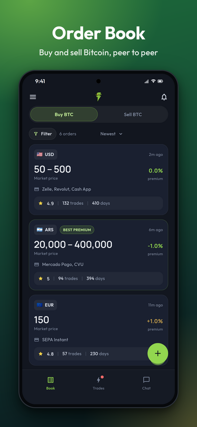

# Mostro App

[Mostro App](https://github.com/MostroP2P/app) is the official application for using Mostro. It is available for Android, iOS, Windows, macOS, Linux and the web. It is still in beta: you will see a *Beta* label in its menu.

## Downloads

- **Android** (7.0 or later): [Zapstore](https://zapstore.dev/apps/foundation.mostro.app) or the APK on [GitHub Releases](https://github.com/MostroP2P/app/releases/latest) (`arm64-v8a` for almost any phone, `armeabi-v7a` for old 32-bit ones).
- **iOS** (14 or later): there is no App Store version yet. The release includes an `.ipa` file you can install with AltStore, Sideloadly or Xcode. Installs signed with a free Apple ID expire after 7 days, and push notifications do not work in them.
- **Windows, macOS and Linux**: [GitHub Releases](https://github.com/MostroP2P/app/releases/latest). The builds are not signed by Apple or Microsoft yet, so the first launch needs one extra step (on Windows, *More info → Run anyway*; on macOS, remove the quarantine flag as the release notes explain).
- **Web**: [mostro.network/app](https://mostro.network/app/). It always runs the latest development build, and you can install it as an app from the browser.

Each release includes a `SHA256SUMS.txt` file to verify your download. Download only from these official sources.

The new app replaces the old *Mostro Mobile* (version 1), and both can be installed side by side. To move over, finish your open trades in the old app and import your 12 words in the new one (see [Account Backup and Restoration](./backup-restore.md)).

## Getting Started

1. Download the app from an official source.
2. When you open it for the first time, your identity is created automatically. A short walkthrough explains how Mostro works.
3. Choose the Mostro node you want to trade on (**Use this node**), or skip to use the default one.
4. Back up your 12 words before trading: *Account → Secret Words → Show words*.
5. Set up your Lightning address or connect a wallet with NWC (optional but recommended).
6. Keep push notifications enabled.
7. Ready to trade.

## Key Features

### Identity and Privacy

- Automatic account creation with a 12-word phrase
- Guided backup and account restoration on any device (*Account → Import Mostro User*)
- Recovery of active trades upon restoration, per node (reputation mode only)
- [Reputation mode or full privacy mode](./privacy.md), under *Account → Privacy*
- Your own reputation on the node you use, under *Account*
- [Import your reputation](./reputation-import.md) from @lnp2pBot or another Mostro node, under *Settings → Network → Reputation*

### Trading

- Order book with **Buy BTC** and **Sell BTC** tabs, filters (currency, payment method, rating, premium) and sorting (newest, best premium, best reputation)
- Create buy and sell orders, with a fixed amount or a range
- Market price with premium or discount, or a fixed price
- Only the currencies the node accepts are offered, including [stablecoins and bitcoin on other networks](./stablecoins.md) where the node enables them
- Take orders; for range orders you enter the amount
- Share an order as a link or a QR code
- [Anti-abuse deposit](./anti-abuse-bond.md) on nodes that use it, and **Claim your share** if your counterparty loses theirs
- Countdown for each step of the trade
- **My Trades** groups your trades into "Needs your action", "In progress" and "Closed"

### Payments

- **Lightning Address** (*Settings → Payments*): when you take a sell order, your sats go to it by default, and you can still choose another address or an invoice for that trade. For your own buy orders, the invoice screen is filled in with it and you confirm.
- **Nostr Wallet Connect (NWC)** (*Settings → Payments → NWC Wallet*): connect your wallet to pay hold invoices and deposits with **Pay with Wallet**, and let it create your invoices automatically. The connection string stays on your device.

### Communication

- End-to-end encrypted chat with your counterparty, one per trade
- Send encrypted photos and PDF files in the chat
- React to and copy messages; messages cannot be deleted or altered
- The chat stays open for an hour after the trade ends, then becomes read-only

### Disputes

- Open disputes directly from the trade screen; follow them under *Chat → Disputes*
- Chat with the solver and attach evidence
- **Share the chat key with the resolver** in one tap, only for that trade
- Messages from [Serbero](./disputes.md#serbero-the-automated-assistant), the automated assistant some nodes use, are labelled as such

### Notifications

- Push notifications for your trades, messages, payments and disputes, configurable one by one under *Settings → Application → Push Notifications*
- Important to keep them enabled so you don't miss the timing of a trade
- Notifications carry no content: they only tell your device there is something to see
- Push works on Android and on official iOS builds; the desktop and web versions show notifications only inside the app
- The bell icon also shows signed announcements from the Mostro project

### Multiple Nodes

- A list of trusted community nodes, with each node's status, fee and deposit (*Settings → Network → Mostro Node*)
- Add your own node by its public key. Verify the key with the operator: a fake node can see your orders.
- A trade stays on the node where it started; **My Trades** shows the trades of the node you have selected
- You still get notifications from trades on other nodes
- *About* shows the limits, fee, deposit, currencies, times and price sources of the node you use

### Multi-language

- Available in English, Spanish, French, German, Italian, Dutch and Portuguese

### Help

- *Settings → Help → Log Report* lets you see and share the app's logs when reporting a problem
- *About → User guide* opens this documentation

## More Information

- Repository: [https://github.com/MostroP2P/app](https://github.com/MostroP2P/app)
- Report bugs: [GitHub Issues](https://github.com/MostroP2P/app/issues)
